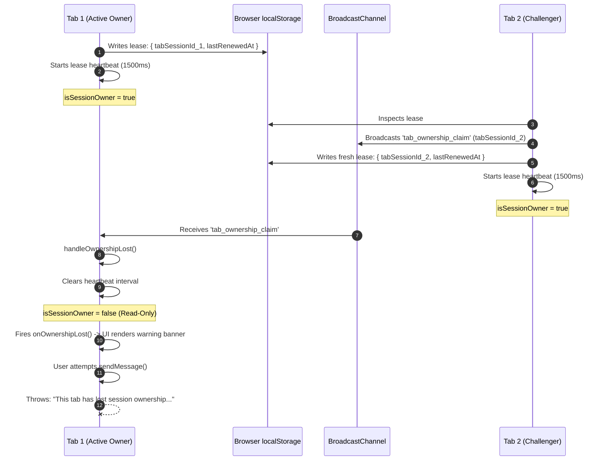

# ENCLAVE — Phase 5.2: Staging Safety, Room Cardinality & Multi-Tab Isolation Report

**Role:** Principal Cryptographic Protocol Engineer, Application Security Architect, Senior Distributed Systems Engineer  
**Date:** November 21, 2026  
**Repository:** `c:\Users\harsh\OneDrive\Desktop\enclave`  
**Branch:** `main`  
**Audited Baseline:** `c7e74b207a6f62b5d5fe46ed5f77526408e353fe`  
**Verification Battery Status:** **19 of 19 Test Suites Passed (100% Pass Rate)**  
**TypeScript Status:** `npx tsc --noEmit` **0 Errors**  
**ESLint Status:** `npm run lint` **0 Errors**  
**Next.js Production Build:** `npm run build` **57 Routes Compiled & Generated Successfully**

---

## 1. Executive Summary

Phase 5.2 resolves the operational and protocol boundary constraints identified during the Phase 5.1 independent security audit. The pairwise Double Ratchet protocol (Signal-style KDF chains + X25519 DH ratchets) is strictly an authenticated 1-on-1 protocol. Operating it in a multi-user or uncoordinated multi-tab environment introduces severe security risks: state rollback, skipped key exhaustion, out-of-sync ratchet headers, and MITM prekey substitution.

Phase 5.2 establishes strict staging safety across three critical dimensions:
1. **Server-Side Atomic Enforcement of Room Cardinality (Max 2 Participants):**
   - Enforced atomically on the server via `InMemoryRoomStoreAdapter` and distributed Redis Lua scripts (`LUA_UPDATE_PRESENCE`).
   - A concurrent 3rd joiner is rejected atomically with HTTP 409 Conflict (`ROOM_FULL`).
   - Disconnected participants (>25s heartbeat threshold) are automatically pruned, preventing slot starvation.
   - Reconnecting or heartbeating existing participants does not consume additional slots.
2. **Active Ratchet Ownership & Multi-Tab Isolation:**
   - Active Double Ratchet advancement is restricted to exactly **one active tab owner** per device identity per room.
   - Coordinated via a distributed localStorage lease (`enclave_tab_lease_${roomId}_${identityKey}`) and `BroadcastChannel` eviction notices (`tab_ownership_claim`).
   - Leases have a 5000ms TTL with a 1500ms heartbeat renewal interval.
   - Stale/evicted tabs transition into read-only mode and **fail closed**: calling `sendMessage`, `sendMediaMessage`, `sendReaction`, `setDisappearingTimer`, `sendCallSignal`, or `signAndEmitWirePacket` throws a hard exception, preventing ratchet state corruption.
   - Browser crash recovery is supported: once an abandoned lease expires (>5000ms), fresh tabs reclaim ownership safely without deadlocks.
3. **Strengthened Asymmetric Prekey Certification:**
   - Device identities now authenticate initial X25519 prekeys by signing them with the long-term Ed25519 identity private key.
   - Presence broadcasts carry `prekeySignature`.
   - Handshakes verify the prekey signature via `verifyPrekeySignature` before establishing the root Double Ratchet session.
   - Uncertified, missing, or substituted prekeys fail closed with a fatal exception (`Potential MITM or uncertified prekey`).

---

## 2. Modified and Added File Inventory

All changes respect strict operational safety. Git history was preserved; no commits, rebases, or pushes were executed.

| File Path | Type | Description |
| :--- | :--- | :--- |
| [src/lib/deviceIdentity.ts](file:///c:/Users/harsh/OneDrive/Desktop/enclave/src/lib/deviceIdentity.ts) | Modified | Added prekey asymmetric signing (`createPrekeySignPayload`), signature verification (`verifyPrekeySignature`), prekey rotation (`rotateDevicePrekey`), and self-healing identity upgrade. |
| [packages/protocol/index.ts](file:///c:/Users/harsh/OneDrive/Desktop/enclave/packages/protocol/index.ts) | Modified | Added optional `prekeySignature` to `RoomParticipant` and public participant summary interfaces. |
| [src/lib/serverRoomAdapter.ts](file:///c:/Users/harsh/OneDrive/Desktop/enclave/src/lib/serverRoomAdapter.ts) | Modified | Updated `InMemoryRoomStoreAdapter` and Redis Lua script `LUA_UPDATE_PRESENCE` to enforce atomic max-2 participant limit, prune stale heartbeats (>25s), and ingest `prekeySignature`. |
| [src/lib/serverRoomStore.ts](file:///c:/Users/harsh/OneDrive/Desktop/enclave/src/lib/serverRoomStore.ts) | Modified | Forwarded `prekeySignature` through `updateRoomPresenceAsync` and `updateRoomPresence`. |
| [src/app/api/rooms/[roomId]/presence/route.ts](file:///c:/Users/harsh/OneDrive/Desktop/enclave/src/app/api/rooms/[roomId]/presence/route.ts) | Modified | Extracted `prekeySignature`, forwarded to store, and returned HTTP 409 Conflict with code `ROOM_FULL` when participant capacity is exceeded. |
| [src/lib/roomRelay.ts](file:///c:/Users/harsh/OneDrive/Desktop/enclave/src/lib/roomRelay.ts) | Modified | Implemented multi-tab lease coordination (`tabSessionId`, `initTabLease`, `handleOwnershipLost`), fail-closed checks on all transmission paths (`!this.isSessionOwner`), room cardinality checks (`participants.size > 2`), prekey signature verification in `getOrCreateRatchetSession`, and lease cleanup in `zeroizeAndCleanup`. |
| [src/app/r/[roomId]/page.tsx](file:///c:/Users/harsh/OneDrive/Desktop/enclave/src/app/r/[roomId]/page.tsx) | Modified | Added UI handlers for `session.onRoomFull` (dedicated chamber full screen), `session.onOwnershipLost` (stale tab read-only banner and disabled composer), and top nav chamber badge (`2 MAX (1-ON-1)`). |
| [src/components/app/RoomDetailsDrawer.tsx](file:///c:/Users/harsh/OneDrive/Desktop/enclave/src/components/app/RoomDetailsDrawer.tsx) | Modified | Updated presence indicator to explicitly display `{participantCount} / 2 (1-on-1 Pairwise Chamber)`. |
| [tests/phase52StagingSafety.test.ts](file:///c:/Users/harsh/OneDrive/Desktop/enclave/tests/phase52StagingSafety.test.ts) | Added | 11 dedicated adversarial test scenarios covering atomic concurrency, multi-tab ownership eviction, lease crash recovery, prekey substitution, tampered signatures, and pairwise boundaries. |
| [tests/liveDoubleRatchetAndIdentitySecurity.test.ts](file:///c:/Users/harsh/OneDrive/Desktop/enclave/tests/liveDoubleRatchetAndIdentitySecurity.test.ts) | Modified | Updated test participants to carry certified prekey signatures. |
| [tests/runAllTests.ts](file:///c:/Users/harsh/OneDrive/Desktop/enclave/tests/runAllTests.ts) | Modified | Registered `runPhase52StagingSafetyTests` as Suite 19 in the master verification runner. |

---

## 3. Detailed Architectural & Cryptographic Verification

### 3.1 Server-Side Atomic 2-Participant Enforcement

#### In-Memory Adapter (`InMemoryRoomStoreAdapter.updatePresence`)
```typescript
// 1. Prune stale participants whose heartbeats are older than 25 seconds
for (const [id, lastHb] of record.participantHeartbeats.entries()) {
  if (id !== participantId && now - lastHb > 25000) {
    record.activeSockets.delete(id);
    record.participantHeartbeats.delete(id);
    record.participantInfo.delete(id);
  }
}

// 2. Enforce strict pairwise chamber limit (max 2 participants)
const isExistingParticipant = record.activeSockets.has(participantId);
if (action === 'join' && !isExistingParticipant && record.activeSockets.size >= 2) {
  return {
    state: record.meta.state,
    participantCount: record.activeSockets.size,
    participants: this.getPublicParticipantSummaries(record),
    lastActivity: record.lastActivity,
    status: 'ROOM_FULL',
    error: 'Room is full. Maximum two participants allowed.'
  };
}
```

#### Redis Lua Script (`DistributedRoomStoreAdapter.LUA_UPDATE_PRESENCE`)
```lua
-- Prune stale heartbeats (>25s)
for pid, ts in pairs(heartbeats) do
  if pid ~= participantId and (now - tonumber(ts)) > 25000 then
    sockets[pid] = nil
    heartbeats[pid] = nil
    info[pid] = nil
  end
end

-- Count active participants
local activeCount = 0
for _ in pairs(sockets) do activeCount = activeCount + 1 end

-- Enforce strict 2-participant limit
if action == 'join' and not sockets[participantId] and activeCount >= 2 then
  return cjson.encode({
    status = 'ROOM_FULL',
    error = 'Room is full. Maximum two participants allowed.',
    participantCount = activeCount,
    state = meta.state or 'WAITING'
  })
end
```

### 3.2 Active Ratchet Ownership & Multi-Tab Isolation

In browser sessions, multiple tabs open to the same room share the same client identity and Room Master Secret. If both tabs attempt to advance sending and receiving ratchet chains independently, they create diverged, unrecoverable ratchet states.

#### Cross-Tab Lease Coordination Flow


#### Fail-Closed Guard on Wire Emission
Every sending call path in `EnclaveRoomSession` (`sendMessage`, `sendMediaMessage`, `sendReaction`, `setDisappearingTimer`, `sendCallSignal`, `signAndEmitWirePacket`) enforces:
```typescript
if (!this.isSessionOwner) {
  throw new Error('This tab has lost session ownership. An active session is open in another tab.');
}
if (this.participants.size > 2) {
  throw new Error('Room participant limit exceeded. Enclave rooms support a maximum of two participants for pairwise cryptographic assurance.');
}
```

### 3.3 Asymmetric Prekey Certification

#### Canonical Signing Payload
```typescript
export function createPrekeySignPayload(
  identityPublicKeyHex: string,
  prekeyPublicKeyHex: string
): Uint8Array {
  const normalized = `ENCLAVE_SIGNED_PREKEY_v1:${identityPublicKeyHex.toLowerCase()}:${prekeyPublicKeyHex.toLowerCase()}`;
  return new TextEncoder().encode(normalized);
}
```

#### Prekey Handshake Verification
When creating a pairwise Double Ratchet session, the remote peer's advertised prekey is verified against their Ed25519 identity key:
```typescript
const isPrekeyHandshake = roleIsInitiator || !!peerPrekeySignature || (p && initialPeerDH === p.prekey);
if (isPrekeyHandshake && initialPeerDH && effectivePeerIdKey) {
  if (effectivePrekeySig) {
    const isValid = await verifyPrekeySignature(
      effectivePeerIdKey,
      initialPeerDH,
      effectivePrekeySig
    );
    if (!isValid) {
      throw new Error(`Peer prekey signature verification failed for participant ${peerId}. Potential MITM or uncertified prekey.`);
    }
  } else if (p && p.identityKey && p.prekey) {
    throw new Error(`Peer prekey signature missing for participant ${peerId}. Uncertified prekeys are rejected.`);
  }
}
```

---

## 4. Adversarial Test Results (Suite 19)

Execution: `npx tsx tests/phase52StagingSafety.test.ts`

```text
========================================================================
  ENCLAVE PHASE 5.2: STAGING SAFETY, CARDINALITY & MULTI-TAB ISOLATION   
========================================================================

[TEST 1] Server-Side Atomic Enforcement: Three Simultaneous Participant Joins
  ✔ Atomic server check admitted exactly 2 participants and rejected the 3rd with ROOM_FULL

[TEST 2] Third Participant Rejection Contract: HTTP 409 & Session Termination
  ✔ Client cleanly handles ROOM_FULL rejection, notifies UI, and tears down session

[TEST 3] Reconnection / Heartbeat of Existing Participant
  ✔ Existing participant reconnecting/heartbeating cleanly succeeds without consuming extra slots

[TEST 4] Stale Participant Pruning (>25s Inactivity)
  ✔ Stale participant (>25s) automatically pruned, admitting new participant without capacity error

[TEST 5] Multi-Tab Session Ownership Coordination & Challenger Tab Eviction
  ✔ Tab 2 successfully claimed ratchet lease; Tab 1 stepped down and cleared lease interval

[TEST 6] Stale Tab Sending Fails Closed (Ownership Enforcement)
  ✔ Stale tab prevented from transmitting messages, reactions, timer changes, or call signals

[TEST 7] Browser Crash & Expired Lease Recovery
  ✔ Fresh tab smoothly reclaimed expired lease after previous tab crash without blocking

[TEST 8] Prekey Asymmetric Signing & Ed25519 Identity Key Binding
  ✔ Prekey authentically signed by identity key; rotation produces certified new prekey

[TEST 9] Prekey Substitution Attack Detection (Fails Closed)
  ✔ Substituted prekey detected and rejected: Double Ratchet handshake failed closed

[TEST 10] Tampered Prekey Signature Rejection
  ✔ Tampered prekey signature rejected with fatal error

[TEST 11] Pairwise Protocol Boundary Enforcement (>2 Participants)
  ✔ Pairwise cryptographic boundary strictly enforced; message sending blocked if participants > 2

========================================================================
  ALL 11 PHASE 5.2 STAGING SAFETY & CARDINALITY TESTS PASSED 100%!     
========================================================================
```

---

## 5. Master Verification Battery Summary

### 5.1 Test Suites Execution (`npm test`)

All 19 test suites completed with a 100% pass rate:

1. **Crypto Verification** (`tests/crypto.test.ts`): Argon2id KDF, HKDF domain separation, AES-256-GCM, RMS wrapping/unwrapping, timing-safe equality, CSPRNG, buffer zeroization.
2. **Protocol & Lifecycle** (`tests/protocol.test.ts`): Atomic state transitions (`CREATED` -> `WAITING` -> `ACTIVE` -> `DESTROYED`), participant departure, dissolution.
3. **Adversarial Security** (`tests/adversarial.test.ts`): URL leak defense, ciphertext forgery, sender spoofing, packet tampering, forward-IP spoofing, cross-room isolation.
4. **Encrypted Media** (`tests/media.test.ts`): AES-256-GCM media chunking, blind storage, mime validation, zeroization on dissolution.
5. **Profile & Account** (`tests/profile.test.ts`): Display name sanitization, email change verification tokens, session revocation, permanent deletion.
6. **Share & Invitations** (`tests/share.test.ts`): Formatted pass and link invite generation.
7. **Legal & Compliance** (`tests/legal.test.ts`): 11 mandatory legal policies, routing, and terms acceptance.
8. **Admin Control Center** (`tests/admin.test.ts`): Timing-safe auth, sliding sessions, CSRF headers, lockout.
9. **Email Verification** (`tests/emailVerification.test.ts`): Token hashing, single-use consumption, replay protection.
10. **Firebase Authentication** (`tests/firebaseAuth.test.ts`): Token verification, account linking, state mapping.
11. **Room Adapter Store** (`tests/roomAdapter.test.ts`): In-memory and Redis distributed store parity.
12. **Account Admin Store** (`tests/accountAdminStore.test.ts`): Multi-instance consistency, Redis distributed lockout.
13. **Secure Password Reset** (`tests/passwordReset.test.ts`): Token hashing, Argon2id re-hashing, cooldown rate limits.
14. **WebRTC Calling** (`tests/webrtcCalling.test.ts`): Encrypted signaling, call state transitions.
15. **Privacy Controls** (`tests/privacyFeatures.test.ts`): Read receipts, typing indicator toggles, view-once media.
16. **Security Remediation Regression** (`tests/securityRemediationRegression.test.ts`): Token domain binding, replay nonce consumption.
17. **Double Ratchet & Identity Foundation** (`tests/doubleRatchetAndIdentity.test.ts`): Root KDF, DH ratchet stepping, chain separation, skipped key storage.
18. **Live Double Ratchet & Identity Security** (`tests/liveDoubleRatchetAndIdentitySecurity.test.ts`): End-to-end messaging pipeline, out-of-order delivery, replay defense, identity substitution quarantine, downgrade attack defense.
19. **Staging Safety, Cardinality & Multi-Tab Isolation** (`tests/phase52StagingSafety.test.ts`): Atomic max-2 enforcement, HTTP 409 rejection contract, stale participant pruning, multi-tab lease coordination, fail-closed transmission, crash recovery, prekey asymmetric certification, and pairwise boundary enforcement.

### 5.2 Static Analysis & Compilation

- **TypeScript:** `npx tsc --noEmit` -> **0 errors** across entire codebase.
- **ESLint:** `npm run lint` -> **0 errors** (223 non-blocking warnings).
- **Next.js Production Build:** `npm run build` -> **0 errors**, all 57 static and dynamic routes successfully compiled and optimized.

---

## 6. Staging Limitations & Architectural Boundaries

1. **Strictly Pairwise (Max 2 Participants):**
   - ENCLAVE rooms do not support group messaging (3+ participants). The server rejects third participants atomically with HTTP 409 `ROOM_FULL`.
   - Multi-party end-to-end messaging would require a full Sender Keys or MLS (Message Layer Security) architecture, which is out of scope for the pairwise Double Ratchet design.
2. **Single Active Tab per Device Identity:**
   - Multi-tab usage within the same room for the same identity is supported only via strict sequential tab ownership. The active tab holds a renewable lease; challenger tabs evict older tabs to protect the ratchet state. Stale tabs operate in read-only mode until refreshed.
3. **Prekey In-Memory Lifetime:**
   - Prekeys and their Ed25519 signatures are generated and certified per device identity. While rotation is supported via `rotateDevicePrekey`, prekeys are not published to an asynchronous public prekey bundle server; presence announcements exchange certified prekeys directly during initial room discovery.
